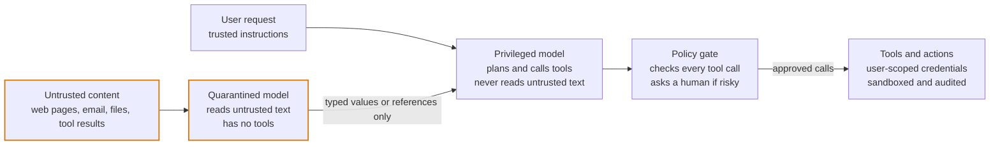

# Cross-cutting concerns

> From *The Agentic Harness: A Layer-by-Layer Guide*, as of 24 October 2026. Principles here change slowly; versions, statuses, prices and dates do not. Verify dated facts against live docs (Context7, or the official pages listed in `sources.md`) before relying on them, or ask the author to run `/dimi:refresh-harness`.

Contents:

- Security and guardrails
- Agent identity and authorisation
- Model gateway, routing and self-hosted inference
- Prompt and configuration management
- Red teaming and adversarial testing
- Runtime patterns
- Data governance and privacy

The four layers above describe what a harness does. The concerns in this part cut across all of them, and they are where enterprise engagements are usually won or lost: security review, identity, model access, change control, adversarial testing, runtime operations and data governance.

## Security and guardrails

Treat the model as an untrusted component: anything it reads can try to steer it, and no prompt reliably prevents that. Security therefore has to be enforced by the harness, in layers, around the model, with the assumption that a determined injection will sometimes get through.

**Threats specific to agents**

| Threat | Example | Primary control |
| --- | --- | --- |
| Direct prompt injection (jailbreak) | A user tells the agent to ignore its rules | Input classifiers; output checks; capability limits that hold even if the model complies |
| Indirect prompt injection | Instructions hidden in a web page, email, PDF or tool result | Treat retrieved content as data; privilege separation (below) |
| Data exfiltration | The agent embeds private data in a link, image URL, email or tool call to an attacker | Egress allowlists; no rendering of untrusted URLs and images; approval on outbound actions |
| Excessive agency | The agent deletes, pays or emails beyond what the task needed | Least-privilege tools; approval gates; budgets |
| Tool and supply-chain compromise | A malicious MCP server or package | Allowlists, version pinning, sandboxing (Part 2) |
| Sensitive data disclosure | PII or secrets appear in answers or logs | PII and secret detection on outputs; redaction in logs |
| Harmful or off-policy output | Toxic content, regulated advice, off-brand claims | Output classifiers; topic restrictions; grounding checks |
| Denial of wallet | Loops or abusive users burn tokens | Rate limits; per-user and per-run budgets |

OWASP's Top 10 for LLM Applications and its agentic-security guidance are useful checklists to map these against in a client's security review.

**Defence in depth, layer by layer**

1. **Input**: classify user input for injection attempts, PII and out-of-scope topics before it reaches the model.
2. **Context**: keep instructions and data in separate channels. Wrap untrusted content in clear delimiters and label its source, so the model and your filters can tell what came from outside.
3. **Capability**: give each agent only the tools its job needs, with the end user's permissions, in a sandbox where code runs.
4. **Action**: check every tool call against policy before it runs, and require human approval for high-impact or outbound actions. Policy engines such as Cedar now sit in the agent path in Bedrock AgentCore and Strands Agents.
5. **Output**: run safety and PII checks, verify citations against retrieved sources, and never render links or images from untrusted content without checking them.
6. **Monitoring**: log guardrail triggers, alert on spikes, and feed blocked attempts into the red-team suite.

**Privilege separation: the strongest structural defence**

Classifiers lower the injection rate; architecture limits the damage when one gets through. The core idea is that the model holding powerful tools never reads untrusted text directly.

*Figure: untrusted content never reaches the model that holds the tools (amber borders mark components that handle untrusted content).*

The quarantined model can be fooled, but all it can return is data; only the privileged model, which never sees the untrusted text, can propose actions, and each one still passes the policy gate.

| Pattern | How it works | Trade-off |
| --- | --- | --- |
| Dual model | A privileged model plans and calls tools using only trusted input; a quarantined model with no tools reads untrusted content and returns typed values or opaque references | Simple and effective; limits what the planner can reason about |
| Plan, then execute | The agent commits to a plan before reading any untrusted data, so injected text cannot add new actions | Weak against injections that corrupt the arguments of planned steps |
| Code, then execute (CaMeL-style) | A privileged model writes a program from the user's request; untrusted values carry provenance tags, and an interpreter blocks flows that break policy, such as data from an external email being sent to an external address | Strongest guarantees; more engineering and some loss of flexibility |
| Action selector | The model only chooses from a fixed menu of actions and never sees tool outputs | Very safe; only fits narrow tasks |
| Context minimisation | Strip the original user prompt or irrelevant content before later steps | Cheap; partial protection |

A useful rule from Meta's "Agents Rule of Two": within one session, without human approval, an agent should combine at most two of three properties: processing untrustworthy input, access to sensitive data or systems, and the ability to change state or communicate externally. It is the same idea as removing one leg of the lethal trifecta.

**Guardrail tools**

| Tool | Type | What it covers |
| --- | --- | --- |
| Llama Guard and Prompt Guard (Meta) | Open-weight classifiers | Unsafe content categories; injection and jailbreak detection |
| Azure AI Content Safety, including Prompt Shields | Cloud service | Harm categories; direct and indirect injection detection |
| Amazon Bedrock Guardrails | Cloud service | Denied topics, PII filters, contextual grounding checks |
| Google Model Armor | Cloud service | Prompt and response screening; integrates with Google's Agent Gateway |
| NVIDIA NeMo Guardrails | Open source | Programmable dialogue and topic rails |
| Guardrails AI, LLM Guard | Open source | Validators for structure, PII, toxicity and secrets |
| Framework hooks | Built in | OpenAI Agents SDK input and output guardrails, ADK callbacks and plugins, Agent Framework and LangChain middleware |

Run cheap checks in parallel with the main model call so they add little latency, and fail closed for high-risk actions. Measure guardrails like any other component: false positives frustrate users, false negatives are incidents.

## Agent identity and authorisation

An agent needs its own identity, separate from both the user and the developer's service account, and every action should record two facts: which agent acted, and on whose behalf. Getting this right is what lets a security team approve an agent that writes to real systems.

**Identity models**

| Model | How it works | Use it for |
| --- | --- | --- |
| Delegated (on behalf of the user) | OAuth token exchange gives the agent a short-lived token scoped to this user and this downstream API | Assistants acting for a person; the enterprise default |
| Agent's own workload identity | A managed identity, service principal or IAM role per agent, with narrow permissions | Background agents with no user present |
| Both | The agent's identity plus the user's delegation, both visible in the audit log | Most production agents |
| Shared service account | One broad credential for everything | Never in production: it bypasses user permissions and hides who did what |

**Platform support in 2026**

The clouds now treat agents as first-class identities. Microsoft gives every new Copilot Studio agent an Entra Agent ID, and Foundry hosted agents each get their own Entra identity ([Copilot Studio](https://learn.microsoft.com/en-us/microsoft-copilot-studio/whats-new), [Foundry](https://learn.microsoft.com/en-us/azure/foundry/agents/overview)). Bedrock AgentCore Identity handles on-behalf-of tokens and a user consent portal ([AWS](https://docs.aws.amazon.com/bedrock-agentcore/latest/devguide/what-is-bedrock-agentcore.html)). Google's Agent Platform has Agent Identity in preview alongside its Agent Gateway and Registry ([Google](https://docs.cloud.google.com/gemini-enterprise-agent-platform/release-notes)). For MCP, the spec binds tokens to a single server, and the Enterprise-Managed Authorization extension lets the company identity provider issue them (Part 2).

**Authorisation: decide outside the model**

- **Check at the tool, not in the prompt.** Every tool call is authorised by code against the user's identity and a policy, whatever the model asked for.
- **Policy engines**: Cedar is now built into the agent path in AgentCore Policy and Strands Agents; Open Policy Agent is common elsewhere. Policies can express rules such as "refunds over £500 need a manager's approval".
- **Fine-grained data permissions**: relationship-based systems such as OpenFGA or SpiceDB suit document-level access for RAG, where permissions follow folders, teams and sharing.
- **Never trust IDs from the model**: if a tool takes a customer ID, verify that the current user may act on that customer. Parameter tampering through injection is a common way round naive checks.

**Credential hygiene**

1. Keep secrets in a vault and inject them at tool execution time; the model never sees a credential, and none appear in prompts, context or traces.
2. Use short-lived, audience-bound tokens, one resource per token.
3. Ask for scopes incrementally, and use step-up authentication for sensitive actions.
4. Keep an inventory of agents with an owner for each; the cloud agent registries (Entra Agent Registry, AgentCore Registry, Google Agent Registry) help.
5. Have a kill switch: revoke one agent's credentials or disable a tool without redeploying.
6. Log agent ID, user ID, tool, target resource and decision for every action.

## Model gateway, routing and self-hosted inference

Put a model gateway between the harness and every model provider. It gives you one place for keys, routing, fallbacks, budgets, caching and logging, and it keeps the harness independent of any one vendor's API, prices or terms.

**What a gateway should do**

- **Unified API**: one interface (usually OpenAI-compatible) across providers and self-hosted models.
- **Keys and access**: central provider keys; per-team or per-agent virtual keys with their own limits.
- **Fallbacks and retries**: switch provider or model on errors, rate limits or timeouts.
- **Budgets and rate limits**: per tenant, per agent and per user, enforced before the call is made.
- **Routing rules**: by task, cost, latency, data sensitivity or region (below).
- **Observability**: tokens, cost and latency per call, exported as OpenTelemetry.
- **Policy**: block disallowed models or regions; attach guardrails centrally.

**Options**

| Kind | Examples |
| --- | --- |
| Open-source proxy you run | LiteLLM |
| Hosted gateway or router | Portkey, OpenRouter, Vercel AI Gateway, Cloudflare AI Gateway |
| API-management products | Kong AI Gateway, Azure API Management AI gateway features |
| Cloud model platforms | Bedrock, Vertex AI and Foundry, which already front many models behind one API |

Pick the one that fits the client's existing network and security tooling; a gateway outside their perimeter may fail security review.

**Routing strategies**

| Strategy | How it works | Typical saving or benefit |
| --- | --- | --- |
| By task | A small, fast model for classification, extraction and routing; a frontier model for planning and hard reasoning | Large cost cut with little quality loss |
| Cascade | Try the cheap model first; escalate when output fails validation or confidence is low | Pays frontier prices only for hard cases |
| By data sensitivity | Send restricted data to a self-hosted or in-region model | Meets residency and confidentiality rules |
| By latency | Fast model for interactive turns, stronger model for background work | Better perceived speed |
| Batch | Send non-urgent work through provider batch APIs | Typically about half price, in exchange for hours of latency |

Every routing rule is a quality decision, so evaluate each route on the eval set rather than assuming the cheaper model copes.

**Self-hosted inference**

Run open-weight models yourself when the client needs air-gapped or sovereign deployment, has high steady volume where GPUs beat per-token pricing, or wants a fine-tuned small model for a narrow task.

| Layer | Options |
| --- | --- |
| Serving engines | vLLM and SGLang (high-throughput production serving), NVIDIA TensorRT-LLM and NIM, Ollama and llama.cpp (local and edge) |
| Open-weight model families | Llama, Qwen, Mistral, Gemma, DeepSeek, OpenAI's gpt-oss |
| Features to require | OpenAI-compatible API, guided decoding for structured output, tool-call parsing, prefix caching, batching |

The trade-offs are real: GPU capacity planning, on-call for inference servers, and a quality gap on long, tool-heavy agent tasks compared with frontier models. Check each model's licence for commercial and user-count restrictions. A common pattern is hybrid: self-hosted models for sensitive extraction and classification steps, and a frontier API for planning on data that is allowed to leave.

## Prompt and configuration management

Prompts, tool definitions, model choices and agent settings are code: they change behaviour as much as any function does. Version them, review them, gate them with evals, and release them with the same discipline as the rest of the system.

**What counts as agent configuration**

| Item | Examples |
| --- | --- |
| Instructions | System prompts, persona and policy text, few-shot examples |
| Tool surface | Tool names, descriptions, schemas, which tools each agent may use |
| Model settings | Model and dated version, temperature, reasoning effort, output limits |
| Retrieval settings | Chunk size, top-k, reranker threshold, filters |
| Guardrails and routing | Classifier thresholds, routing rules, budgets |
| Packaged knowledge | Skills (`SKILL.md` folders) and `AGENTS.md` files |

**Practices that hold up**

1. **Keep it in git** beside the code, reviewed through pull requests, with the eval suite run in CI and blocking regressions.
2. **Record the version on every trace**, so any production behaviour can be traced back to the exact prompt, tools and model that produced it.
3. **Use a prompt registry where non-engineers edit**: LangSmith, Langfuse, MLflow and Braintrust all offer one. Treat registry versions like releases: immutable IDs, eval results attached, and a sync back to git.
4. **Pin model versions.** Use dated model snapshots, not floating aliases, and treat a model upgrade as a release with a full eval run and a rollback plan.
5. **Roll out gradually.** Serve a new configuration to a small share of traffic, compare online metrics with the old version, then widen; rollback is switching the version flag.
6. **Template, don't concatenate.** Insert variables into fixed slots; never splice untrusted text into the instruction section.
7. **Order for caching.** Stable content first (instructions, tool definitions, skills index), variable content last, so prompt caching keeps working (Part 4).
8. **Keep a changelog** linking each configuration change to its eval results and the reason for it.

**AGENTS.md and skills**

`AGENTS.md`, now an Agentic AI Foundation project, is a plain Markdown file in a repository that tells coding agents how to build, test and follow conventions there ([AAIF](https://aaif.io/)). Skills package a procedure with its scripts and resources so any compatible agent can load it on demand (Part 2). For an FDE, both are a way to hand over operational knowledge: the client's own coding agents can then maintain the system using the conventions you wrote down.

## Red teaming and adversarial testing

Red teaming attacks your own agent before anyone else does. The question is not whether the model can be tricked (it can) but whether the harness's controls still hold when it is: whether a successful injection can actually leak data, take an action or reach another user's records.

**Start with a threat model**

- **Assets**: the data the agent can read, the actions it can take, the money or systems it touches.
- **Attackers**: external users, authors of content the agent will read (web pages, emails, uploaded files, tickets), malicious insiders, compromised tools or sub-agents.
- **Entry points**: the chat box, every retrieval source, every tool result, every MCP server, every agent it talks to over A2A.

**What to test**

| Category | Example attack | Pass condition |
| --- | --- | --- |
| Direct jailbreak | Role-play or encoding tricks to bypass rules | Capability limits hold even if the model complies |
| Indirect injection | Hidden instructions in a document, email or web page the agent retrieves | No unapproved action or data egress results |
| Exfiltration | Get the agent to put private data in a link, image URL, email or tool argument | Egress controls block it |
| Cross-user access | Ask for another customer's data, or tamper with IDs in tool calls | Authorisation at the tool refuses |
| Excessive agency | Talk the agent into a destructive or financial action | Approval gate or policy engine stops it |
| Prompt and config extraction | Extract the system prompt or tool list | Nothing secret is in the prompt to begin with |
| Denial of wallet | Trigger loops or huge outputs | Budgets stop the run |
| Multi-turn manipulation | Build trust over several turns, then escalate | Same controls apply on turn 20 as on turn 1 |
| Compromised component | A sub-agent or MCP server returns malicious output | Downstream controls treat it as untrusted |

**Tools**

- **PyRIT** (Microsoft): an open-source framework for automating attacks against generative AI systems.
- **garak** (NVIDIA): an open-source scanner that probes models for known vulnerability classes.
- **promptfoo**: red-team plugins and attack strategies that run as test suites in CI ([promptfoo](https://www.promptfoo.dev/docs/intro/)).
- **AgentDojo**: a research benchmark of prompt-injection attacks against tool-using agents, useful for comparing defences.
- **Inspect AI**: build custom adversarial evals with sandboxed agents ([Inspect](https://inspect.aisi.org.uk/)).

**Process**

1. Run an automated attack suite in CI so a prompt or tool change cannot silently reopen a closed hole.
2. Do a manual red-team exercise before launch and before major changes, ideally by people who did not build the agent.
3. Measure attack success rate by category, counting real impact (data left, action taken), not just bad text.
4. Fix with controls (permissions, egress rules, approvals, privilege separation) rather than prompt patches, which attackers route around.
5. Re-test, record results in the security sign-off, and add every new attack to the suite.

## Runtime patterns

Agent runs are long, bursty and stateful, so they fit badly into a plain request-response web service. The runtime needs streaming, background execution, queues and limits, and it must survive deploys in the middle of a run.

**Execution patterns**

| Pattern | What it is | Use it for |
| --- | --- | --- |
| Streaming | Send tokens, tool-call events and status updates as they happen, over server-sent events or WebSockets | Chat interfaces; perceived speed |
| Resumable streams | The client can reconnect and pick up the event stream where it dropped | Mobile users and flaky networks; supported by Vercel AI SDK, Agno and Cloudflare Agents |
| Background runs | Start a run, return a run ID immediately, notify on completion by webhook, email or push | Anything over about 30 seconds: research, reports, batch jobs |
| Queue-based workers | Runs go on a durable queue and a pool of workers pulls them | Spiky load, retries, fair sharing between tenants |
| Scheduled agents | Cron-triggered runs | Daily briefings, monitoring, reconciliation |
| Event-triggered agents | A webhook or event starts a run | A ticket opened, an email received, a file uploaded |

**Concurrency and limits**

- **Shared provider limits**: requests and tokens per minute are shared by every agent on a key. Enforce them centrally in the gateway with a token-bucket limiter, and queue rather than fail.
- **Per-tenant quotas and priorities**: interactive runs should jump ahead of batch work; one tenant's burst should not starve the others.
- **Timeouts at every level**: per tool call, per model call, per step and per run.
- **Double-texting**: decide what happens when a user sends a new message mid-run: queue it, interrupt and restart, or merge it into the running context.
- **Sandbox pools**: keep warm sandboxes ready if code execution is on the critical path, since cold starts add seconds.

**Deploying without breaking in-flight runs**

Keep workers stateless and all run state in the checkpoint store, so any worker can resume any run. When a deploy changes a workflow, either drain old runs first or pin each run to the version that started it: Agent Framework, for example, cannot resume a checkpoint if the workflow's topology changed, and durable engines such as Temporal have explicit workflow versioning. Managed runtimes also impose session limits (Bedrock AgentCore sessions last up to eight hours by default, with a 15-minute idle timeout), so design long jobs to checkpoint and continue.

**User interface protocols**

- **AG-UI**: a standard event stream between the agent backend and the frontend, carrying text, tool calls, state updates and approval prompts; supported by most major frameworks ([AG-UI](https://github.com/ag-ui-protocol/ag-ui)).
- **MCP Apps**: lets a tool return interactive UI that the host renders (Part 2).
- **Framework UI kits**: OpenAI ChatKit, Vercel AI SDK UI and CopilotKit speed up chat interfaces with streaming, tool views and approvals built in.

Design the interface to show progress honestly: the current step, what the agent is waiting for, and a clear approve or reject control when a human is needed.

## Data governance and privacy

An agent copies client data into many places: prompts, provider-side state, vector stores, checkpoints, memory, caches, traces and eval sets. Governance means knowing where every copy goes, who can read it, how long it stays, and how it is deleted.

**Map every place data lands**

| Location | What it holds | Controls to set |
| --- | --- | --- |
| Model provider | Prompts and outputs, possibly retained briefly for abuse monitoring | Data processing agreement, zero data retention where eligible, region, no-training terms |
| Provider-hosted features | Conversation state, uploaded files, hosted vector stores, managed agent sessions, hosted traces | Check eligibility one feature at a time (below) |
| Vector store | Chunk text and embeddings | Encryption, document ACLs, residency; treat embeddings as sensitive, since research has shown they can be partly inverted back to text |
| Checkpoints and memory | Conversation history and facts about users | Retention limits, user-visible memory, deletion on request |
| Traces and logs | Prompts and outputs if captured | Redaction, separate content store, retention, access control (Part 4) |
| Caches | Prompt prefixes, semantic caches | Scope per tenant; never share across tenants |
| Eval datasets | Real-shaped cases by default (the structure, edge cases and expected outcomes of real work, with synthetic content); real client cases only anonymised and with the client's consent | Store real cases under the client's data policy, never in this plugin's repository; set retention |

**Zero data retention is per feature, not per account**

Several hosted features fall outside zero-data-retention or regulated-data terms even when the core API qualifies. Examples from this guide: Anthropic's MCP connector is not eligible for zero data retention, Claude Managed Agents is not eligible for zero data retention or a HIPAA business associate agreement, and OpenAI Agents SDK tracing is unavailable to zero-data-retention organisations ([Anthropic](https://platform.claude.com/docs/en/agents-and-tools/mcp-connector), [Anthropic](https://platform.claude.com/docs/en/managed-agents/overview), [OpenAI](https://openai.github.io/openai-agents-python/tracing/)). Build a feature-by-feature eligibility list with the client before choosing tools.

**Practices**

1. **Classify data and route by class**: decide which classes may go to which models and regions, and enforce it in the gateway.
2. **Keep data in region**: use in-region endpoints from the cloud platforms or providers when residency applies.
3. **Make deletion reach everywhere**: a deletion request must remove data from memory, vector stores, checkpoints, logs, caches and eval sets, not just the primary database.
4. **Isolate tenants**: separate indexes or namespaces, or row-level security, and include cross-tenant leakage in red-team tests.
5. **Minimise**: send the model only the fields a step needs; mask identifiers that are not required for the task.
6. **Document it**: a data-flow diagram and a data protection impact assessment for EU personal data, plus sector rules such as HIPAA or PCI DSS where they apply.

None of this is legal advice; the client's data-protection officer and counsel make the final calls, but an FDE who arrives with the data map already drawn shortens that review by weeks.
