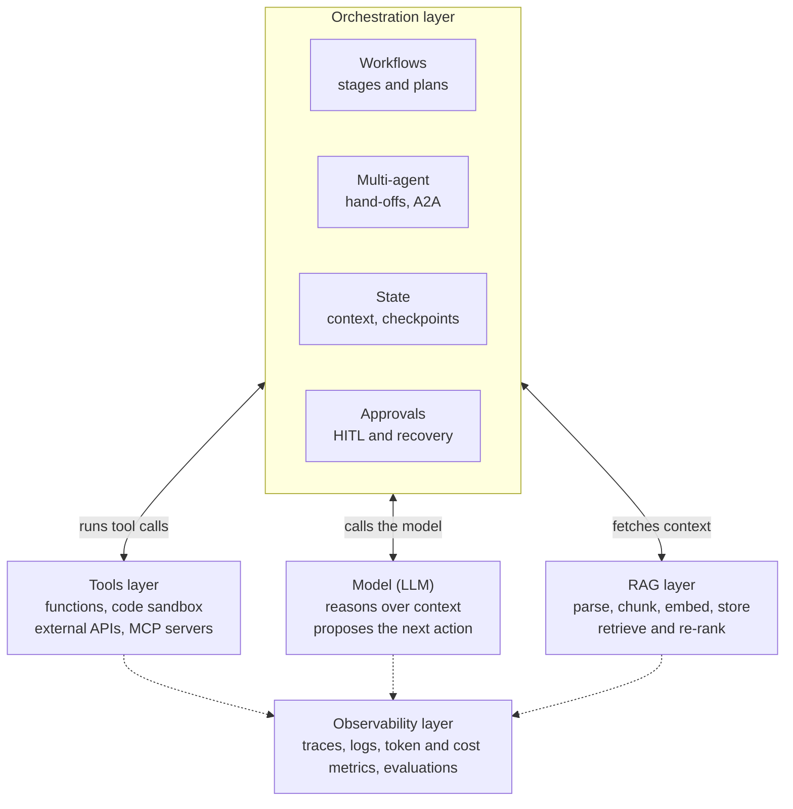

# Overview: what an agentic harness is

> From *The Agentic Harness: A Layer-by-Layer Guide*, as of 24 October 2026. Principles here change slowly; versions, statuses, prices and dates do not. Verify dated facts against live docs (Context7, or the official pages listed in `sources.md`) before relying on them, or ask the author to run `/dimi:refresh-harness`.

Contents:

- Overview

## Overview

An agentic harness wraps four layers around a model: orchestration decides what happens next, tools let the agent act, RAG supplies knowledge, and observability shows what happened and how well. The model reasons; the harness does everything else.

Every harness runs the same core loop. It sends the model a goal, some context and a list of tools. The model replies with an answer or a tool call. The harness runs the tool, adds the result to the context, and calls the model again until the task is done or a limit is hit.

| Layer | Question it answers | Main parts |
| --- | --- | --- |
| Orchestration | What runs next, and who does it? | Workflows, planning, multi-agent hand-offs, approvals, checkpoints, state, recovery |
| Tools | What can the agent do? | Built-in functions, code execution, APIs, MCP servers |
| RAG | What does the agent know beyond its training? | Loading, parsing, chunking, embedding, storage, retrieval, re-ranking |
| Observability | What happened, what did it cost, was it any good? | Monitoring, tracing, logging, cost and latency metrics, evaluation |

The layers are separate on paper but tangled in practice. Most agent frameworks cover orchestration and tools well; RAG and observability are often added from specialist libraries and platforms.

*Figure: the model reasons; the harness does everything else.*

Orchestration sits on top and drives the model, the tools and retrieval; observability records every one of those calls underneath.
